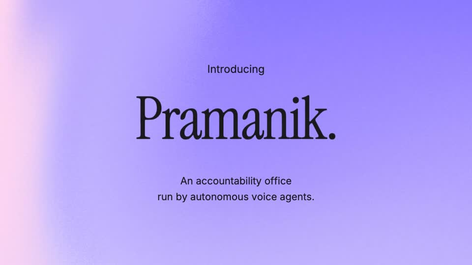

# Pramanik

Pramanik is a shared community office staffed by autonomous voice agents. Its agents work together like a team of employees: they collect civic issues, call responsible officers and local leaders, and keep following up for better infrastructure and public services. The whole community can inspect their work on one public dashboard.

[](https://github.com/yash-dot-com/pramanick/raw/refs/heads/main/public/pramanik-overview.mp4)

[Watch the video · 1 minute 53 seconds](https://github.com/yash-dot-com/pramanick/raw/refs/heads/main/public/pramanik-overview.mp4)

## The problem

India has a follow-up problem. Communities pay taxes and report civic problems, yet residents must still chase officers for answers and repairs. Most people cannot spend their days making calls and checking promises. Pramanik gives the community an office that takes on this work.

## How the community office works

- Residents bring local issues, photos, and locations to one shared community office.
- Intake agents combine duplicate complaints so the community can pursue the same problem together.
- A coordinator divides work among specialist agents that check evidence, history, and responsibility in parallel.
- Research agents use public ward directories to identify relevant officers, offices, and local representatives.
- Voice agents call designated contacts in Hindi, Marathi, or English to ask what will be done and by when.
- Agents remember earlier conversations, question missed promises, and schedule further calls without residents chasing each update.
- Completion claims trigger resident surveys and photo checks, with GPT-assisted assessment supporting human review.
- Conflicting evidence keeps the issue open or reopens it so the office can ask for answers again.
- The public dashboard shows the office’s shared workload, call records, summaries, commitments, evidence, and next actions.
- Everyone can contribute evidence and inspect whether public-service commitments lead to verified improvements.

## What powers the office

- The OpenAI Agents SDK coordinates the main agent and parallel specialists.
- GPT-5.4 mini supports reasoning, case memory, tool use, and evidence assessment.
- GPT-Realtime-2.1 powers the agents’ voice conversations.
- Bolna provides the phone number and calling connection.
- Persistent background jobs carry follow-ups forward after each call.

## Run locally

Install dependencies and configure the variables described in [.env.example](.env.example).

```bash
npm install
npm run dev
```

Run the follow-up worker in a separate terminal:

```bash
npm run worker
```

See the [backend setup](docs/CORE-BACKEND.md), [environment and call configuration](docs/DEMO.md), and [video source](output/showcase/PROJECT-MOTION-VIDEO.md) for details.
